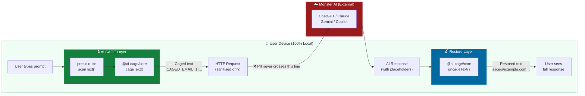
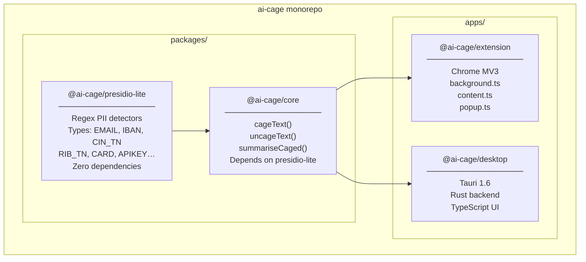
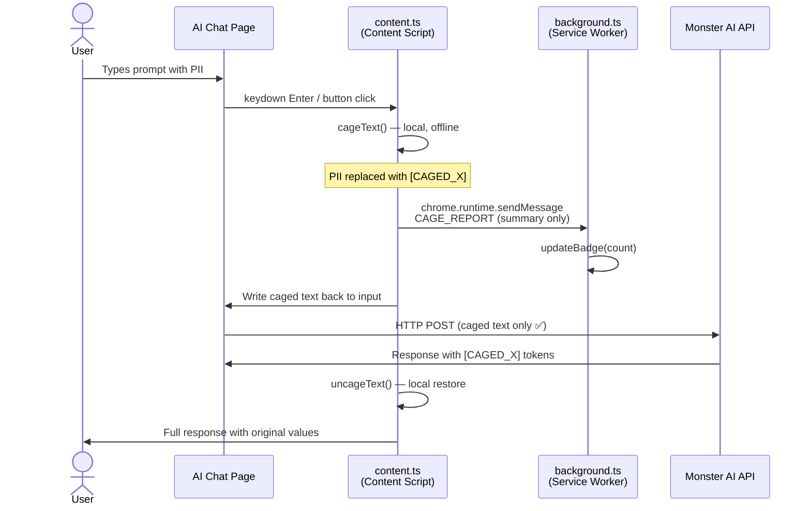

# AI CAGE — Architecture

> **Core Principle:** PII never leaves the user's machine. Caging happens before the network. Uncaging happens after.

---

## High-Level Data Flow

---

## Component Map

---

## Package Responsibilities

| Package | Language | Role | Network? |
|---------|----------|------|----------|
| `@ai-cage/presidio-lite` | TypeScript | Regex PII pattern library | ❌ Never |
| `@ai-cage/core` | TypeScript | `cageText` / `uncageText` API | ❌ Never |
| `@ai-cage/extension` | TS + Chrome APIs | MV3 content/background scripts | ❌ Never¹ |
| `@ai-cage/desktop` | Rust + TypeScript | Tauri native desktop app | ❌ Never² |

> ¹ The extension intercepts network traffic but does NOT initiate any itself.
> ² `tauri::api::http` is explicitly disabled in `Cargo.toml` and `tauri.conf.json`.

---

## Extension Runtime Architecture (MV3)

---

## Cage Architecture — 7 Threat Surfaces

AI CAGE is designed around 7 threat surfaces ("cages"). V1 implements **Cage 1**.

| # | Cage Name | V1 Status | Description |
|---|-----------|-----------|-------------|
| 1 | **Chat Leak** | ✅ Implemented | PII in prompts sent to AI chat interfaces |
| 2 | Shadow AI | 🔜 Planned | Employees using unapproved AI tools |
| 3 | Agent Rogue | 🔜 Planned | AI agents with tool-use accessing internal systems |
| 4 | Code Leak | 🔜 Planned | Source code + secrets pasted into AI code assistants |
| 5 | Voice/Video | 🔜 Planned | Transcripts and meeting summaries sent to AI |
| 6 | Credential Hijack | 🔜 Planned | API keys / passwords in AI context windows |
| 7 | Compliance | 🔜 Planned | GDPR/HIPAA/SOC2 audit trail generation |

---

## Design Decisions

### Why regex and not an ML model?

- **Offline-first**: No model download, no inference server, zero latency on first use.
- **Auditable**: Every detection rule is a readable regex in `detectors.ts`. Security engineers can review without an ML background.
- **Deterministic**: Same input → same output. Reproducible in court/audit.
- **Zero cost**: No GPU, no cloud, no subscription.

ML-based NER (e.g. a WASM ONNX model) is planned for V2 for higher recall on unstructured names and addresses.

### Why Tauri and not Electron?

- ~10× smaller binary (no bundled Chromium).
- Rust backend = memory-safe, no Node.js attack surface.
- `tauri::api::http` is explicitly disabled — the Rust process literally cannot make HTTP calls.

### Why MV3 and not MV2?

- MV3 is the only supported extension model going forward in Chrome.
- Service workers (not persistent background pages) reduce memory footprint.
- `declarativeNetRequest` (future) is more privacy-preserving than `webRequest`.
