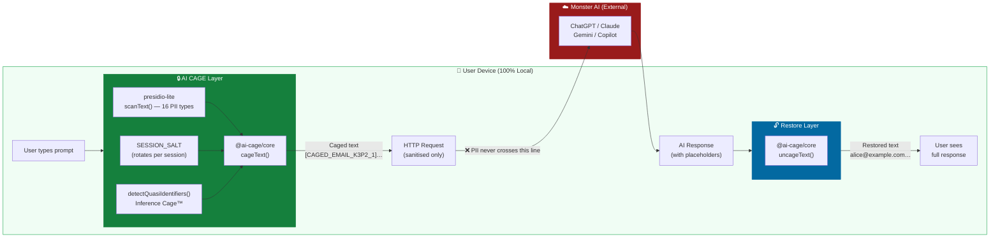
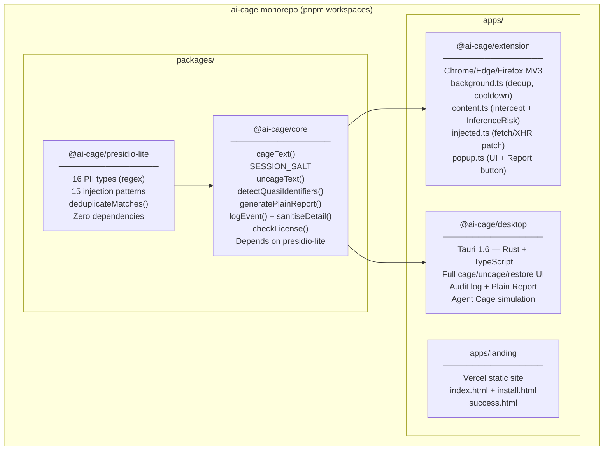
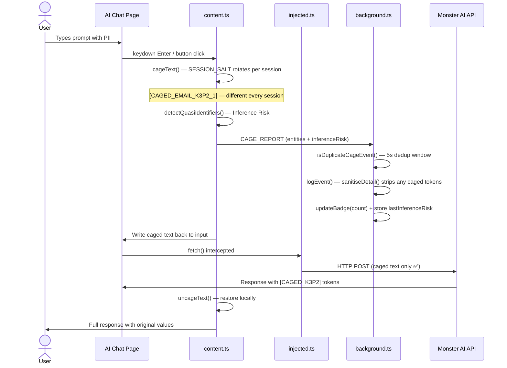

# AI CAGE — Architecture

**Version:** v0.6.0
**Last updated:** 2026-11-14

> **Core Principle:** PII never leaves the user's machine. Caging happens before the network. Uncaging happens after. Tokens rotate every session.

---

## High-Level Data Flow



---

## Component Map



---

## Package Responsibilities

| Package | Language | Role | Network? |
|---------|----------|------|----------|
| `@ai-cage/presidio-lite` | TypeScript | 16 PII regex detectors + 15 injection patterns | ❌ Never |
| `@ai-cage/core` | TypeScript | cageText / uncageText / SESSION_SALT / InferenceRisk / generatePlainReport / auditLog / license | ❌ Never |
| `@ai-cage/extension` | TS + Chrome APIs | MV3 content/background/injected scripts + popup | ❌ Never¹ |
| `@ai-cage/desktop` | Rust + TypeScript | Tauri native desktop app | ❌ Never² |

> ¹ Extension intercepts network traffic but initiates zero requests itself.
> ² `tauri::api::http` is explicitly disabled in `Cargo.toml`.

---

## Extension Runtime Architecture (MV3)



---

## Key Design Patterns

### SESSION_SALT — Ephemeral Tokens™

```typescript
// packages/core/src/cage.ts
function generateSessionSalt(): string {
  const chars = 'ABCDEFGHJKLMNPQRSTUVWXYZ23456789';
  return Array.from({length: 4}, () => chars[Math.floor(Math.random() * chars.length)]).join('');
}
export const SESSION_SALT: string = generateSessionSalt(); // once per module load = once per session
```

Each session gets a unique 4-char salt. `[CAGED_EMAIL_K3P2_1]` in session 1 becomes `[CAGED_EMAIL_A7X9_1]` in session 2. The AI cannot correlate prompts across sessions — this is the Linkage Attack prevention guarantee.

### Deduplication Pipeline

```
content.ts fires CAGE_REPORT
    → background.ts: isDuplicateCageEvent(site, count, entityTypes, 5s window)
        → If duplicate: skip logEvent, still update badge
        → If new: logEvent() + sanitiseDetail() strips any CAGED tokens from detail field
    → generatePlainReport(): dedupedCageEvents — second dedup layer at report time
```

### Inference Risk

```typescript
// packages/core/src/cage.ts
// 8 quasi-identifier patterns:
// age, team_size, amount, specific_date, city, role, deal_ref, sector
// Rule: score >= 3 → risky = true → warn (Free) or auto-cage (Pro)
export function detectQuasiIdentifiers(text: string): InferenceRisk
```

### Shadow AI Cooldown

```typescript
// apps/extension/src/background.ts
const SHADOW_COOLDOWN_MS = 5 * 60 * 1000; // 5 minutes per hostname
// Same hostname logged at most once per 5 min — prevents ChatGPT polling spam
```

---

## The 9 Cages — v0.6.0 Status

| # | Cage Name | v0.6.0 Status | Implementation |
|---|-----------|:-------------:|----------------|
| 1 | **Chat Leak** — PII in AI prompts | ✅ **Live** | `cageText()` + content.ts |
| 2 | **Shadow AI** — 47 unmonitored endpoints | ✅ **Live** | `matchAiEndpoint()` + background.ts |
| 3 | **Agent Rogue** — Prompt injection + tool policy | ✅ **Live** | `cageToolCall()` + `scanForInjection()` |
| 4 | Code Leak — VS Code extension | 🔜 v0.7.0 | Planned |
| 5 | Voice/Video — Meeting transcripts | 🔜 v0.7.0 | `cageTranscript()` partial |
| 6 | Credential Hijack — API keys | ⚡ Partial | Covered by Cage 1 (API_KEY detector) |
| 7 | **Compliance** — Audit log + CSV + Plain Report | ✅ **Live** | `logEvent()` + `generatePlainReport()` |
| 8 | **Inference Cage™** — Quasi-identifier combinations | ✅ **Live** | `detectQuasiIdentifiers()` |
| 9 | **Ephemeral Tokens™** — Session token rotation | ✅ **Live** | `SESSION_SALT` in `cage.ts` |

---

## Design Decisions

### Why regex and not an ML model?

- **Offline-first**: Zero model download, zero inference server, zero latency.
- **Auditable**: Every detection rule is a readable regex in `detectors.ts`.
- **Deterministic**: Same input → same output. Reproducible in court/audit.
- **Zero cost**: No GPU, no cloud, no subscription.

ML-based NER is on the v0.8.0 roadmap for higher recall on unstructured names.

### Why SESSION_SALT instead of a fixed counter?

Fixed tokens like `[EMAIL_1]` are stable across sessions — the AI can correlate 10 sessions of the same user into a behavioral profile without ever seeing direct PII. A per-session random salt makes cross-session correlation mathematically infeasible.

### Why deduplication at two layers?

The extension has two intercept paths: DOM mutation (content.ts) and network fetch (injected.ts). Both fire for the same user action. Without dedup, every cage event is counted twice. The 5-second + entity-fingerprint window handles SW restarts between events.

### Why sanitiseDetail() in logEvent()?

The `detail` field in audit entries comes from background.ts string interpolation. If that string accidentally contains a caged token (e.g., from a site's own debug output), the audit log becomes unreadable. `sanitiseDetail()` replaces any `[CAGED_..._N]` pattern with `[PROTECTED]` before writing to storage.

### Why Tauri and not Electron?

- ~10× smaller binary (no bundled Chromium).
- Rust backend — memory-safe, `tauri::api::http` explicitly disabled.
- Native OS integration without Node.js attack surface.

### Why MV3 and not MV2?

MV3 is the only supported Chrome extension model going forward. Service workers reduce memory footprint. `webRequest` is replaced by `declarativeNetRequest` on the roadmap.

---

## Security Contracts (CI-enforced)

```bash
# Pre-commit hook — blocks any commit that adds network calls to core
grep -r "fetch\|XMLHttpRequest\|WebSocket\|navigator.sendBeacon" packages/core/src packages/presidio-lite/src
# Must return zero matches

# Vite bundle check (release.ps1 step 2b)
# Verifies desktop dist/index.html contains no old version strings
```
